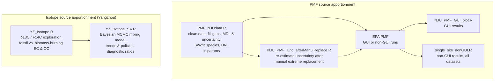

# JS_SA

PM2.5 source apportionment (2016-2020) in Jiangsu Province, China: **Nanjing** and **Yangzhou**.

This repository contains the R scripts used to:

1. pre-process PM2.5 speciation data (elements, ions, OC/EC and carbon fractions, PAHs) from **Nanjing University (NJU)** and the **Jiangsu Provincial CDC (JS-CDC)**;
2. prepare inputs for EPA **Positive Matrix Factorization (PMF)**, both GUI and non-GUI (command line), using **dispersion normalized PMF (DN-PMF)**;
3. summarize and plot the PMF results;
4. use **dual-carbon-isotope method [stable carbon (δ¹³C) and radiocarbon (F¹⁴C) isotopes]** of EC and OC in Yangzhou to separate fossil and biomass-burning carbon, and apportion EC to coal, traffic, C3-plant and C4-plant burning with a **Bayesian MCMC isotope mixing model**;
5. relate source trends to air-pollution control policies, and check sources with species diagnostic ratios.

---

## Contents

- [Workflow](#workflow)
- [Data](#data)
- [Scripts](#scripts)
  - [PMF: input preparation](#pmf-input-preparation)
  - [PMF: results and plots](#pmf-results-and-plots)
  - [Isotope analyses and Bayesian source apportionment](#isotope-analyses-and-bayesian-source-apportionment)
- [Software](#software)
- [Notes](#notes)
- [Related repository](#related-repository)

---

## Workflow

---

## Data

Raw data are **not** included in this repository.

| Dataset | Content | Used in |
|---|---|---|
| Detection limits | LODs for ICP-MS elements, IC ions and PAHs | `PMF_NJUdata.R`, `NJU_PMF_Unc_afterManulReplace.R` |
| Nanjing, NJU | PM2.5 elements, ions and carbon | `PMF_NJUdata.R`, `NJU_PMF_Unc_afterManulReplace.R`, `NJU_PMF_GUI_plot.R`, `single_site_nonGUI.R` |
| Yangzhou, JS-CDC | PM2.5 elements (ICP-MS), ions, OC/EC and carbon fractions, PAHs; updated element (2024.06) and OC/EC data | `PMF_NJUdata.R`, `single_site_nonGUI.R`, `YZ_isotope_SA.R` |
| Yangzhou isotopes | δ¹³C of EC, OC and TC; F¹⁴C of EC (AMS) | `YZ_Isotope.R`, `YZ_isotope_SA.R` |
| Source endmembers | δ¹³C and F¹⁴C of coal, traffic (two groups), C3 plants and C4 plants, from Nanjing literature data | `YZ_Isotope.R`, `YZ_isotope_SA.R` |

### Dataset names used in file names, for PMF

| Name | Meaning |
|---|---|
| `NJ_NJUdata_mannual_rmv_extremes_4.5unc_intp` | Nanjing NJU data, extremes removed manually, gaps interpolated, 4.5× extra uncertainty for interpolated values |
| `NJ_NJUdata_mannual_rmv_extremes_4.5unc_intp_DN` | The same, dispersion-normalized |
| `YZ_Csub` | Yangzhou, OC/EC sub-fractions, no PAHs |
| `YZ_OCEC` | Yangzhou, total OC/EC, no PAHs |
| `YZ_OCEC_pah` | Yangzhou, total OC/EC, with PAHs |

---

## Scripts

### PMF: input preparation

| Script | Description |
|---|---|
| `PMF_NJUdata.R` | Prepares PMF inputs for Nanjing and Yangzhou. Handles extremes and negative values, fills missing values (geometric mean / interpolation), estimates Si from Si/Al in Nanjing, updates JS-CDC elements and OC/EC, and builds concentration and uncertainty files with extra uncertainty for interpolated points. Writes GUI inputs (with and without dispersion normalization) and non-GUI inputs: strong / weak / bad (S/W/B) classification by signal-to-noise and fraction above MDL, combined concentration-uncertainty files, and `iniparams.txt` for base, bootstrap (BS) and displacement (DISP) runs. Earlier versions of the Nanjing preparation (2024.02–05) are kept at the top of the script. |
| `NJU_PMF_Unc_afterManulReplace.R` | After extreme values in the Nanjing DN dataset are replaced manually (by monthly means), finds the revised data points, converts them back to non-DN values, re-estimates their uncertainty (4.5× extra), and writes the new dispersion-normalized concentration and uncertainty files. |

### PMF: results and plots

| Script | Description |
|---|---|
| `NJU_PMF_GUI_plot.R` | Reads EPA PMF **GUI** outputs (base-run profiles and contributions, DISP) for Nanjing and plots source profiles, daily / annual / monthly / year-month contributions (concentration and fraction), G-space plots, and predicted vs. observed PM2.5. |
| `single_site_nonGUI.R` | Loops over all five datasets and processes **non-GUI** PMF outputs. Finds the base-run task with the lowest Q, extracts profiles and contributions, adds BS and DISP results, and computes scaled residuals and Q/Qexp. Assigns sources, then writes summary tables (base / DISP summary, factor correlations, PMF vs. observations) and figures (source profiles, time series at several time scales, residuals, observed vs. predicted). |

### Isotope analyses and Bayesian source apportionment

| Script | Description |
|---|---|
| `YZ_Isotope.R` | Explores Yangzhou δ¹³C and F¹⁴C data: isotope biplots against Nanjing source endmembers (all data, by season and by year), PM2.5 / OC / EC trends, and EC and OC changes under two season definitions. Estimates fossil-fuel and biomass-burning EC and OC from F¹⁴C, with Theil–Sen trends. |
| `YZ_isotope_SA.R` | Bayesian MCMC isotope mixing model (δ¹³C + F¹⁴C) that apportions EC to coal, traffic, C3-plant and C4-plant burning (also a version that splits traffic into two groups). Uses single and three-chain runs with diagnostics: acceptance rate, effective sample size, Gelman–Rubin. Converts source fractions to concentrations by season and year. Tests seasonal and year-season trends (Mann–Kendall with Hirsch–Slack correction, Theil–Sen) against the timeline of national, regional and Jiangsu air-pollution and coal policies. Also splits traffic into diesel and gasoline with diagnostic ratios, correlates sources with species and ratios (ions, elements, PAHs), and compares two JS-CDC element measurements using Al-based enrichment factors. |

---

## Software

- **R** packages: `data.table`, `dplyr`, `plyr`, `tidyr`, `purrr`, `zoo`, `lubridate`, `readxl`, `stringr`, `ggplot2`, `ggsci`, `ggpattern`, `ggthemes`, `ggh4x`, `gridExtra`, `patchwork`, `scales`, `deming`, `coda`, `MASS`, `EnvStats`.
- **EPA PMF 5.0**, GUI and command-line versions.

---

## Notes

- **Paths are hard-coded.** Scripts point to local Dropbox and `Documents` folders. Edit `setwd()` and the file paths before running.
- **Scripts are run section by section** in RStudio rather than top to bottom. Some sections are alternatives (for example, the dataset settings in `PMF_NJUdata.R`).

---

## Related repository

[HEI_PMF_nationalSA](https://github.com/TingAilsa/HEI_PMF_nationalSA): national PM2.5 source apportionment for the US, fro which the DN-PMF scripts were originally drafted.
